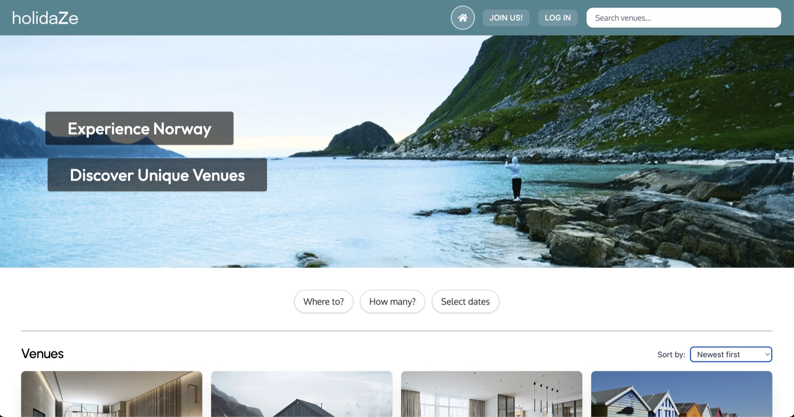
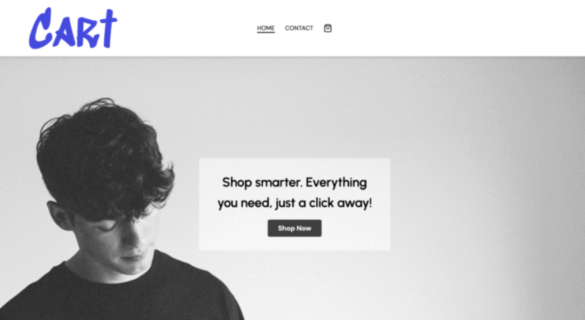
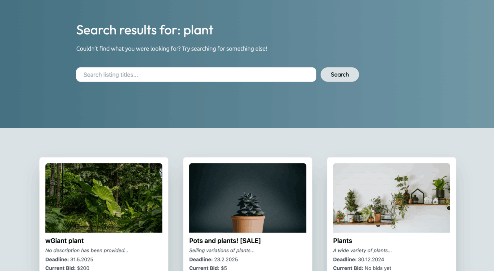

# Marte's Portfolio

A personal portfolio for my frontend development work and experience. The site separates professional experience from study projects that I can share publicly.

**Live portfolio:** [portfolio2-mn.netlify.app](https://portfolio2-mn.netlify.app/)

## About

I’m a developer, Tech Owner, and project lead at Nettbureau. I build web experiences with JavaScript and React, contribute to backend work with TypeScript and Node.js, and coordinate development projects across teams. Before moving into development, I worked with CRM, customer journeys, and technical support at Jottacloud. I completed Noroff’s two-year Frontend Development program in 2025.

## Featured projects

### Holidaze — Noroff final exam

A responsive accommodation booking application for guests and venue managers. Guests can browse venues, check availability, and manage bookings. Venue managers can create and manage listings and reservations.



- [Live project](https://holidaze-pe2-mn.netlify.app/)
- [Source code](https://github.com/marned91/Holidaze-PE2)
- Built with React, TypeScript, Vite, Tailwind CSS, React Router, and the Noroff API.

### CART — JavaScript Frameworks

A responsive storefront with product discovery, cart state, and a checkout flow.



- [Live project](https://cart-js-framework.netlify.app/)
- [Source code](https://github.com/marned91/javascript-framework-ca)
- Built with React, TypeScript, Zustand, Tailwind CSS, and the Noroff API.

### ReUze — Semester Project 2

An auction platform for browsing and listing second-hand goods and placing bids.



- [Live project](https://reuze.netlify.app/)
- [Source code](https://github.com/marned91/ReUze-SP2)
- Built with JavaScript, Tailwind CSS, and the Noroff API.

## Portfolio technology

- React and JavaScript (JSX)
- Vite
- Tailwind CSS
- React Router
- React Icons

## Run locally

```bash
npm install
npm run dev
```

Create a production build with `npm run build` and preview it with `npm run preview`.

## Contact

- [GitHub](https://github.com/marned91)
- [LinkedIn](https://www.linkedin.com/in/marte-n-18aab5101/)
